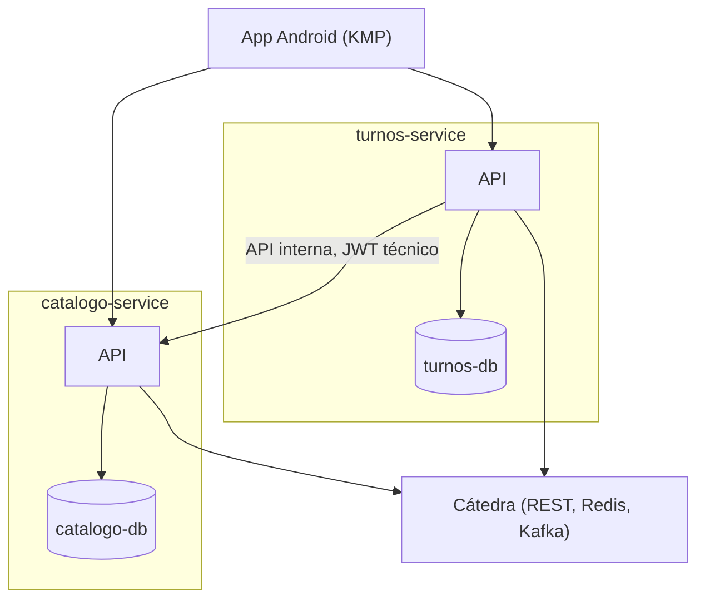

# Arquitectura

- La app Android corre fuera de los contenedores y consume directamente a los dos servicios.
- Cada servicio tiene su propia base, sin acceso cruzado a tablas del otro.
- `turnos-service` llama a `catalogo-service` solo por su API interna (`/api/internal/**`), nunca accede a su base.
- Los dos servicios se integran por separado con la cátedra: `catalogo-service` sincroniza el catálogo (REST, Redis, Kafka); `turnos-service` gestiona reservas (REST, Kafka).

## Organización interna

Cada servicio sigue arquitectura hexagonal con slicing vertical: un paquete por funcionalidad, cada uno dividido en `domain` (modelo y ports), `application` (casos de uso) e `infrastructure` (JPA, REST, Kafka). En `turnos-service` hay un solo paquete de negocio, `reservation`, porque la disponibilidad y las reservas comparten el mismo proceso y sus estados. Lo que usa todo el servicio (seguridad JWT, clientes REST, token de servicio, Kafka y Swagger) está en `shared`. El detalle de cada caso de uso está en `docs/casos-de-uso.md`.
