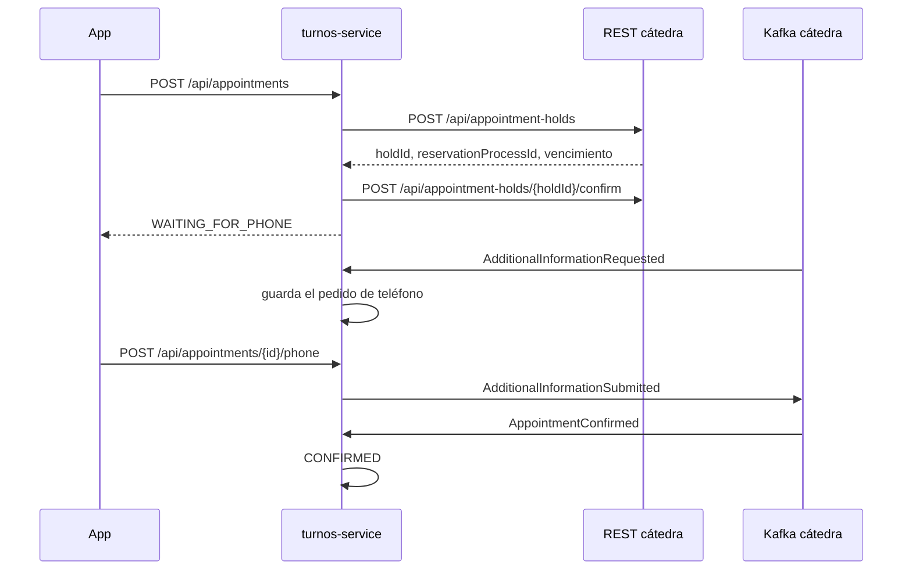
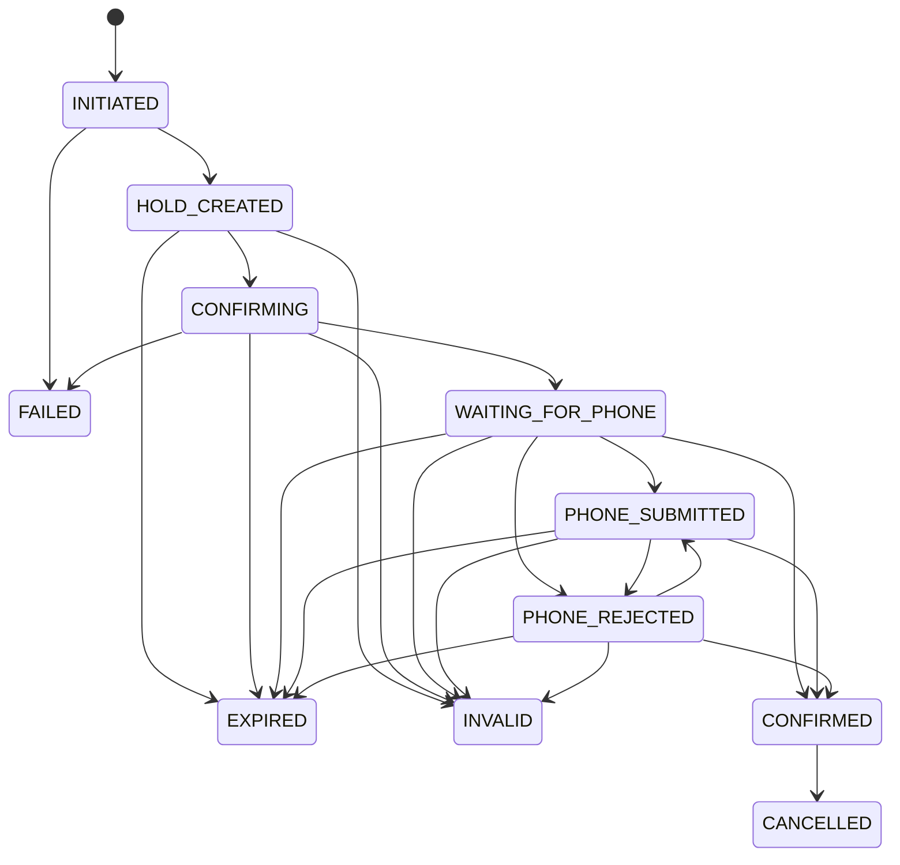

# Integración con la cátedra

## Flujo de reserva

El turno se bloquea y se confirma por REST, y el resto del proceso llega por Kafka.

En lugar de la confirmación, la cátedra puede responder con `AdditionalInformationRejected` (el usuario puede reenviar el teléfono), `AppointmentProcessExpired` o `AppointmentProcessInvalid`. Una reserva confirmada se cancela por REST (`POST /api/appointments/{reservationProcessId}/cancel`), y la cátedra informa la cancelación con `AppointmentCancelled`.

Para la disponibilidad se consultan los turnos ocupados (`GET /api/appointment-occupancies`), y para listar las reservas del usuario y recuperar procesos, el listado de reservas (`GET /api/appointments`).

## Estados del proceso

El estado local de cada proceso sigue esta máquina de estados. Antes de cualquier llamada a la cátedra o publicación en Kafka se valida que la transición sea válida.

`CANCELLED`, `EXPIRED`, `INVALID` y `FAILED` son finales. Una acción del usuario con una transición inválida responde `409`.

## Idempotencia y recuperación

- **Mensajes duplicados:** cada evento tiene un `eventId` único. Antes de procesarlo se chequea si ya está guardado en `processed_event`; si ya está, se ignora. El evento se registra en la misma transacción que el cambio de estado.
- **Mensajes fuera de orden o tardíos:** si un evento pide una transición que la máquina de estados no permite (por ejemplo, una confirmación sobre un proceso ya vencido), se ignora y se loguea.
- **Mensajes perdidos:** al arrancar, el servicio consulta a la cátedra las reservas de los procesos que quedaron abiertos y los lleva al estado que ella informa. También se consulta a la cátedra al pedir el estado de un proceso que venció sin conocerse el resultado.
- **Vencimiento local:** si el proceso pasó su vencimiento mientras se esperaba al usuario, se vence localmente al consultarlo, sin esperar el evento.
- **Confirm sin respuesta:** si la cátedra no responde al confirmar, el proceso queda en `CONFIRMING`, porque no se sabe si la confirmación se aplicó, y se resuelve con el evento que llegue o con la recuperación.
- **Pedidos y eventos al mismo tiempo:** el proceso tiene una columna `version`. Si un pedido de la app y un evento de Kafka lo modifican a la vez, se conserva el estado que dejó el evento.
- **Mensajes mal formados:** si un mensaje no se puede leer, se registra en el log y se sigue con el siguiente, sin trabar el consumer.
