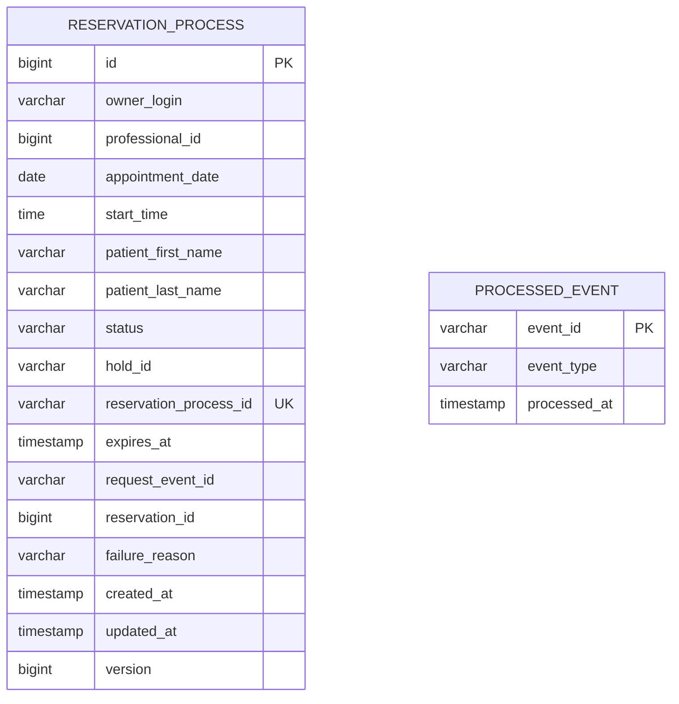

# Modelo de datos

Base propia (`turnos_db`), de uso exclusivo de turnos-service. Ningún otro servicio accede a estas tablas directamente. turnos-service no guarda una copia del catálogo: los datos de profesionales, horarios y usuarios los consulta a catalogo-service en el momento, a través de su API interna (`docs/contratos.md`).

- `reservation_process`: cada proceso de reserva de un usuario, con su estado local.
  - `owner_login`: el login del usuario dueño del proceso, tomado del JWT. Se usa para que cada usuario vea y cancele solo sus reservas.
  - `professional_id`, `appointment_date` y `start_time`: el turno pedido. `professional_id` es el mismo id que usan la cátedra y catalogo-service, sin clave foránea porque el profesional no está en esta base.
  - `patient_first_name` y `patient_last_name`: el nombre del usuario, obtenido de catalogo-service al iniciar la reserva y necesario para confirmar el hold.
  - `hold_id`, `reservation_process_id`, `request_event_id` y `reservation_id`: los ids que asigna la cátedra durante el proceso. `reservation_process_id` es único y es el que traen los eventos de Kafka.
  - `status`, `expires_at` y `failure_reason`: el estado del proceso, su vencimiento y el motivo si terminó rechazado, vencido o inválido.
  - `version`: se incrementa en cada cambio, para detectar cuando un pedido de la app y un evento de Kafka modifican el mismo proceso al mismo tiempo.
- `processed_event`: eventos de Kafka ya procesados, para idempotencia.

El esquema se crea con migraciones de Flyway (`src/main/resources/db/migration`), y Hibernate solo valida que las entidades coincidan con las tablas.
